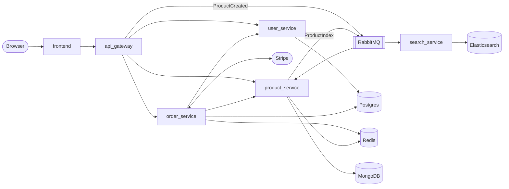

# PCStore

An online PC store built as Go microservices behind an API gateway, with a React storefront.
Orders reserve stock in Postgres and are paid through Stripe Checkout. The whole stack (services,
databases, message broker, metrics and centralised logs) starts with one `docker compose` command.

**Stack:** Go 1.25, Gin, pgx, MongoDB, Redis, RabbitMQ 4 (AMQP 1.0), Stripe, Elasticsearch ·
React 19, Vite, Redux Toolkit, Tailwind · Prometheus, Grafana, Filebeat, Kibana, k6

## Architecture



| Service | Code | Responsibility | Data |
|---|---|---|---|
| frontend | `frontend/DDStore` | Storefront and admin pages, served by nginx | — |
| api_gateway | `backend/DDStore/apps/api_gateway` | Single entry point (`/api/v1`): checks the login cookie and role, then proxies to the service. Publishes new products to RabbitMQ. | — |
| user_service | `apps/user_service` | Accounts, login, roles (`user`, `admin`, `owner`) | Postgres `ddstore_users` |
| product_service | `apps/catalog_service` | Products and categories; sends every change to search | MongoDB, Redis cache |
| order_service | `apps/order_service` | Orders, stock, Stripe payments, guest checkout | Postgres `ddstore_orders`, Redis |
| search_service | `apps/search_service` | Full-text product search ([README](backend/DDStore/apps/search_service/README.md)) | Elasticsearch |

`apps/model` holds the Go models the services share.

### Placing an order

1. The client sends `POST /api/v1/order`, or `POST /api/v1/order/guest` without logging in.
2. order_service refuses at once (409) any item that an earlier order recently found out of stock;
   these quantities are cached in Redis for a minute.
3. It gets current prices from product_service and reserves each item's stock in Postgres with a
   conditional update, so concurrent orders can't oversell. A product whose last unit is sold is
   marked out of stock in the catalog.
4. The client opens a Stripe Checkout session (`POST /api/v1/payment/checkout/:id`; guest checkout
   returns it directly) and pays on Stripe's page. Stripe then calls `/payment/webhook`, which
   records the payment.
5. A sweep every 5 minutes cancels orders left unpaid for more than 5 minutes, and their stock
   goes back.

## Getting started

**Requirements:** Docker with Compose v2 (Docker Desktop on Windows or macOS). Optional: the
[Stripe CLI](https://docs.stripe.com/stripe-cli) for webhooks, Go 1.25 to run the tests, Node.js 20+
to run the frontend outside Docker.

```bash
cd backend/DDStore
cp .env.example .env        # then fill it in, see below
docker compose up -d --build
```

Open http://localhost:5173 and sign in as **admin1 / admin01**. The first start seeds that admin,
3 categories and 5 products with 100 units of stock each.

### Configuration

Secrets live in `backend/DDStore/.env`, which is git-ignored. Never write real keys into
`docker-compose.yaml`.

| Variable | Used for |
|---|---|
| `JWT_SECRET` | Signs login cookies. Defaults to `change-me`. |
| `STRIPE_SECRET_KEY` | Stripe **test-mode** secret key ([dashboard](https://dashboard.stripe.com/test/apikeys)) |
| `STRIPE_WEBHOOK_SECRET` | Verifies the calls Stripe makes to `/payment/webhook` |
| `NGROK_AUTHTOKEN`, `NGROK_URL` | The optional ngrok tunnel for Stripe webhooks |

`docker compose up` starts every service, ngrok included. Without `NGROK_AUTHTOKEN` the ngrok
container keeps restarting; run `docker compose stop ngrok` if you use the Stripe CLI instead.

### Stripe webhooks

Stripe has to reach order_service to confirm payments. Use one of:

- **Stripe CLI:** run `stripe listen --forward-to localhost:7777/payment/webhook`, put the
  `whsec_…` it prints in `STRIPE_WEBHOOK_SECRET`, then `docker compose up -d order_service`.
- **ngrok:** the tunnel forwards to order_service. Its public URL is shown at
  http://localhost:4040; add `<url>/payment/webhook` as an endpoint in the Stripe dashboard and use
  that endpoint's signing secret.

Pay with the test card `4242 4242 4242 4242`, any future date and any CVC.

### Local URLs

| URL | What | Login |
|---|---|---|
| http://localhost:5173 | Storefront | admin1 / admin01 |
| http://localhost:9999/api/v1 | API gateway | |
| http://localhost:3000 | Grafana | admin / admin |
| http://localhost:9090 | Prometheus | |
| http://localhost:5601 | Kibana (logs) | |
| http://localhost:15672 | RabbitMQ management | ddstore / ddstore |
| http://localhost:5050 | pgAdmin | admin@ddstore.com / ddstore |
| http://localhost:8081 | mongo-express | admin / ddstore |
| `mongodb://127.0.0.1:27018/?directConnection=true` | MongoDB Compass | |
| http://localhost:4040 | ngrok inspector | |

These logins are local development defaults; change them before exposing the stack anywhere.
Postgres, Redis and Elasticsearch aren't published to the host: use pgAdmin, mongo-express and
Kibana, which reach them on the Compose network.

## API

All routes are under `http://localhost:9999/api/v1`. `POST /user/login` with `{ "name", "password" }`
sets the `access_token` cookie that the other routes check.

| Resource | Routes | Access |
|---|---|---|
| Users | `POST /user` (sign up), `POST /user/login`, `GET /user/logout`, `GET /user/refresh`, `GET /user/me`, `PUT` / `DELETE /user/:id` | Changing an account: that user, or admin / owner |
| Products | `GET /product`, `GET /product/:id`, `GET /product/category/:id`, `POST /product`, `PUT` / `DELETE /product/:id` | Read: anyone. Write: admin / owner. Delete: owner |
| Categories | `GET /category`, `GET /category/:id`, `POST /category`, `PUT` / `DELETE /category/:id` | Same as products |
| Orders | `POST /order`, `GET /order/history`, `GET /order/:id`, `GET /order`, `PUT` / `DELETE /order/:id`, `POST /order/completeOrder/:id` | Logged in. Listing, changing and cancelling: admin / owner |
| Guest checkout | `POST /order/guest` | Anyone; returns the order id and the Stripe Checkout URL |
| Payment | `POST /payment/checkout/:id` | Logged in; returns the Stripe Checkout URL |
| Stock | `GET /stock?ids=…`, `POST /stock/:id/add` | admin / owner |

An order body lists its items:

```json
{ "data": [{ "productId": "665000000000000000000001", "quantity": 1 }] }
```

Guest checkout adds the customer: `{ "name": "...", "email": "...", "data": [ ... ] }`.

## Observability

- **Logs.** Every Go service writes JSON logs. The gateway gives each request an `X-Transaction-Id`
  (or keeps the one the client sends), passes it to every service it calls and returns it in the
  response. Filebeat ships the logs to Elasticsearch: in Kibana, open **Discover → DDStore logs** and
  search `transaction_id : "<id>"` to follow one request through all services.
  `LOG_LEVEL` is `1` for requests and queue messages only, `2` to also log each service function's
  input and output. Level 2 includes request data such as passwords, so use 1 outside development.
- **Metrics.** Each service serves Prometheus metrics on its internal port 2112, and Prometheus
  also scrapes RabbitMQ, Postgres, MongoDB and Redis. Grafana opens on the **DDStore Overview**
  dashboard; **DDStore Databases** covers the databases.

## Load test

[`loadtest/place-orders.js`](backend/DDStore/loadtest/place-orders.js) places 1000 orders at the same
moment, then checks that stock stayed consistent (nothing oversold or lost). Run it from
`backend/DDStore` with the stack up:

```bash
docker run --rm -i --network ddstore_default -e BASE_URL=http://api_gateway:10000/api/v1 \
    grafana/k6:2.2.0 run - < loadtest/place-orders.js
```

On PowerShell:

```powershell
Get-Content loadtest/place-orders.js -Raw | docker run --rm -i --network ddstore_default -e BASE_URL=http://api_gateway:10000/api/v1 grafana/k6:2.2.0 run -
```

The options (`ORDERS`, `MODE=user|guest`, `PRODUCT_ID`, ...) are described at the top of the script.

## Tests

```bash
cd backend/DDStore/apps/order_service   # or any other service
go test ./...
```

## Repository layout

```
backend/DDStore/
├── apps/
│   ├── api_gateway/       # entry point, auth, reverse proxy
│   ├── user_service/
│   ├── catalog_service/   # runs as product_service
│   ├── order_service/     # orders, stock, Stripe
│   ├── search_service/
│   └── model/             # shared Go models
├── deploy/                # Postgres init, Prometheus, Grafana, Filebeat, Kibana, pgAdmin config
├── loadtest/              # k6 scripts
├── docker-compose.yaml
└── .env.example
frontend/
├── DDStore/               # React storefront
└── StatusBoard/           # status page run on the host (npm run dev, port 5180)
```
